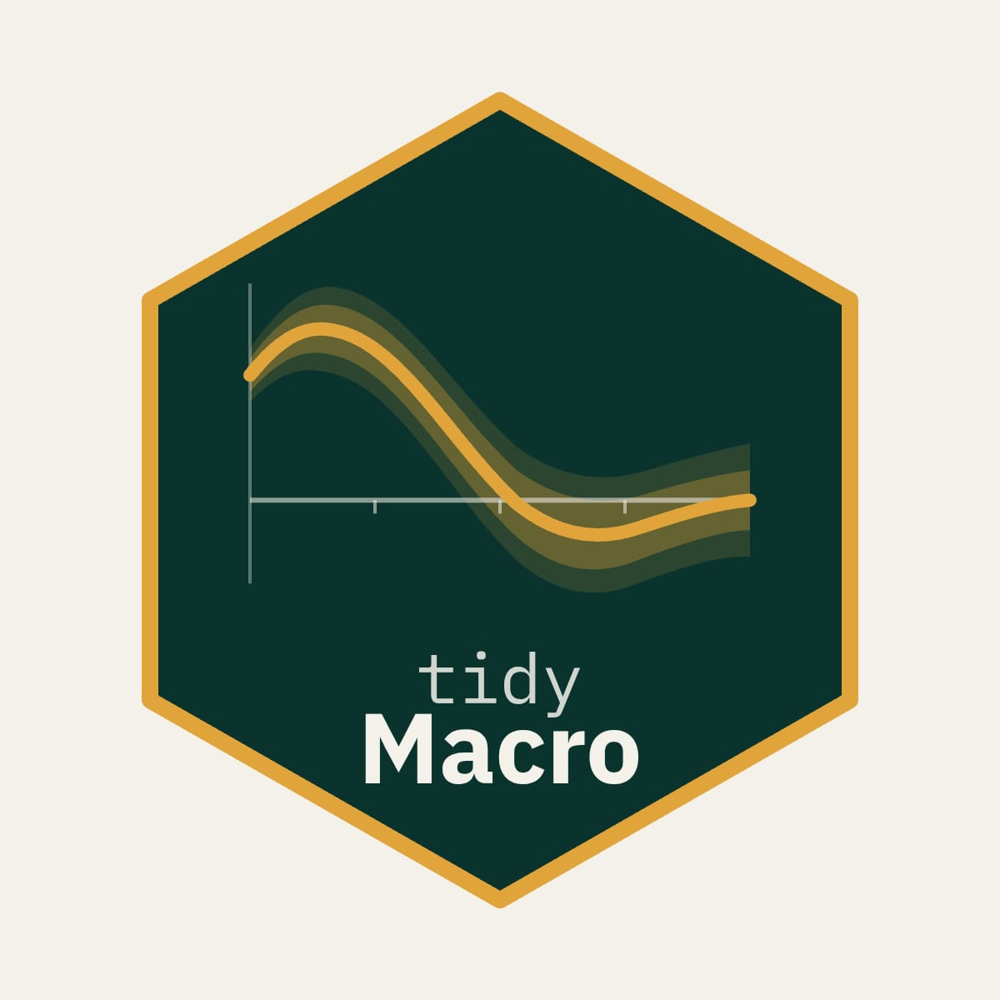

# tidyMacro 

&nbsp;
[](https://tidymacro.netlify.app/)

Welcome! Full documentation and function references are available at <https://tidymacro.netlify.app>. For a comprehensive overview of the package's functionality and replication examples, a separate replication gallery is provided on the main webpage of the package.

## Installation

```r
# install.packages("devtools")
devtools::install_github("muhsinciftci/tidyMacro")
```

## How tidyMacro is built and checked

tidyMacro is developed with AI coding agents, under significant human review, and every method is checked against the original studies.

### Multi-agent development

The code is written mainly with Claude (Claude Code). Codex independently cross-checks the work. Each agent has a narrow role:

| Agent | Role |
|---|---|
| C++ engineer | Implements and refactors the RcppArmadillo routines |
| Numerical-methods reviewer | Checks the econometrics and numerics of VAR, SVAR, IV, sign restriction, bootstrap and local projection code |
| R interface reviewer | Checks the R wrappers, plots and exported functions |
| Check runner | Compiles the package and runs the tests and diagnostics |

The reviewer and check-runner agents cannot edit the code. When the agents disagree, the code and the reference output settle it, not either model.

### Human review

The author designs and reviews every function, one at a time. That covers inputs, outputs, defaults, speed and memory use. AI errors found during development are corrected by hand. Where tidyMacro deliberately differs from an original implementation, the documentation says so.

### Comparison with the original studies

- **Authors' code.** C++ ports are compared with the output of the original MATLAB and Stata code, such as the VAR Toolbox of Cesa-Bianchi and the authors' replication files. Stochastic methods, such as bootstraps and sign restrictions, are compared on their distributions rather than on single draws.
- **Published results.** The [replication gallery](https://tidymacro.netlify.app) re-estimates published studies with tidyMacro and sets the results against the papers:

  | Method | Replicated study |
  |---|---|
  | Short-run (recursive) restrictions | Bloom (2009) |
  | Long-run and mixed restrictions | Galí (1999); Beaudry and Portier (2014) |
  | External instruments (proxy SVAR) | Känzig (2021) |
  | Noninvertible shocks | Forni, Gambetti and Ricco (2022), using the Gertler and Karadi (2015) instrument |
  | Internal instruments; heteroskedasticity | Känzig (2021) |
  | Sign, narrative and sign + IV restrictions | Uhlig (2005); Antolín-Díaz and Rubio-Ramírez (2018); Arias, Caldara and Rubio-Ramírez (2019); Cesa-Bianchi and Sokol (2022) |
  | Local projections and LP-IV | Jordà and Taylor (2025) |
  | State-dependent local projections | Tenreyro and Thwaites (2016) |
  | Panel local projections | Mian, Sufi and Verner (2017) |
  | LP difference-in-differences | Dube, Girardi, Jordà and Taylor (2025) |

- **Test suite.** The testthat suite compares estimators with independent reference implementations, such as the Newey-West and cluster-robust standard errors. It also checks that results do not depend on the number of threads.
